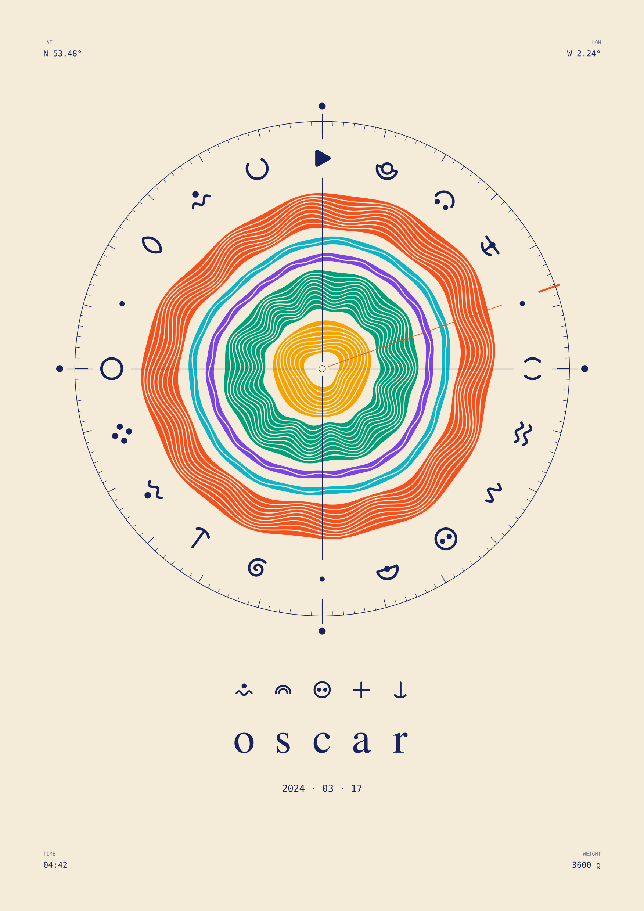
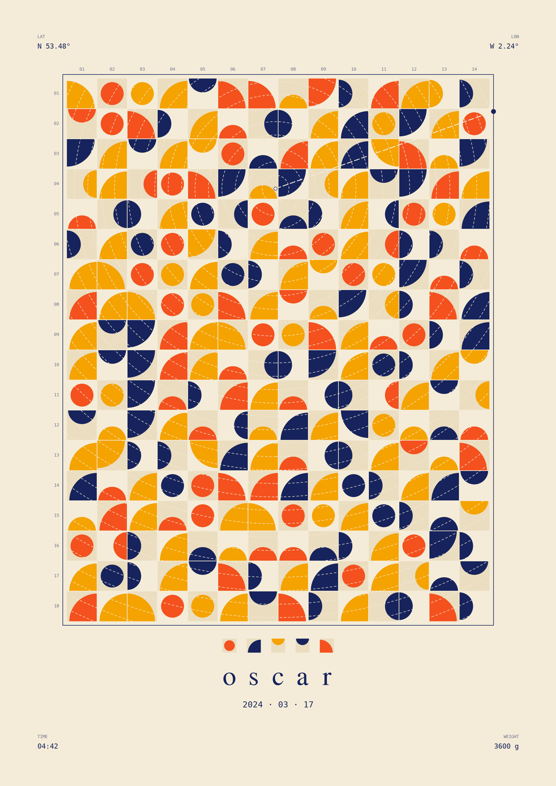

# Art prints

Scripts that turn a few personal details into a print. Each art style lives in its own folder under `styles/` and stands alone: its own script, its own instructions, its own example output.

## Styles

| Style | What it makes |
|---|---|
| [growth-rings](styles/growth-rings/) | A birth print. Wavy growth rings built from a name, date, time, weight and place, with a message hidden in a ring of glyphs and a sealed card that explains how to read it. |
| [patchwork](styles/patchwork/) | A birth quilt. A patchwork of round shapes in three inks, one patch for each letter of a message of up to 50 words, keyed by the name, date, time and weight, with a sealed card that explains how to read it. |
| [little-town](styles/little-town/) | A birth print a child of about eight can read. A town where every letter of a message of up to 50 words is a house: count its windows, look at its colour, find the letter in a chart that starts with the first letter of the name. |






## Layout

```
styles/
  growth-rings/
    birthprint.py     the script
    README.md         how to run it
    examples/         output made from placeholder details
  patchwork/
    quiltprint.py     the script
    README.md         how to run it
    examples/         output made from placeholder details
  little-town/
    townprint.py      the script
    README.md         how to run it
    examples/         output made from placeholder details
```

## Adding a style

Make a new folder under `styles/` and give it the same three things:

1. The script.
2. A `README.md` that says how to run it.
3. An `examples/` folder holding output made from placeholder details.

Then add a row to the table above.

## Keep real details out

Each script writes to a folder called `out/`, and `.gitignore` leaves every `out/` folder out of the repo. A real print carries a real name, date and place, so it stays on your own machine. Only the `examples/` folders are tracked, and they should only ever hold placeholder details.
