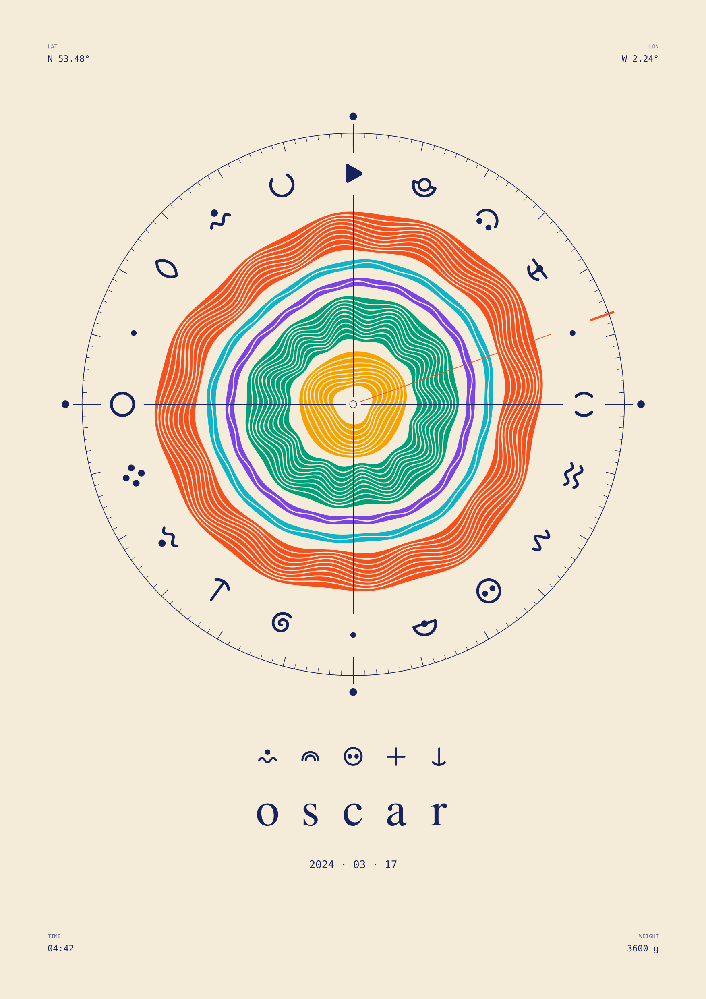

# Growth rings: a birth print

One script, `birthprint.py`. You give it a name, a date, a time, a weight, a place and a message. It writes the print, a preview and the sealed card that explains how to read the message.



## 1. Set up (once)

1. Install Python 3.9 or newer from python.org if you don't have it. To check, open a terminal and type `python3 --version` (on Windows: `py --version`).
2. Install the three libraries it needs:

   ```
   python3 -m pip install matplotlib numpy pillow
   ```

   On Windows use `py -m pip install matplotlib numpy pillow`.

## 2. Run it

Open a terminal in this folder (`styles/growth-rings`) and run this as one line with your own details in the quotes:

```
python3 birthprint.py --name "oscar" --date 20240317 --time 04:42 --weight "3600 g" --coords "N 53.48, W 2.24" --message "the quick brown fox" --size "A3 portrait"
```

On Windows, start the line with `py` instead of `python3`.

If you'd rather not type the options, run `python3 birthprint.py` on its own and it asks for each detail in turn.

## 3. What you get

Everything lands in a folder called `out`, named after the name you gave. The repo's `.gitignore` excludes `out`, so a real print is never committed by accident.

| File | What it is |
|---|---|
| `oscar_print.pdf` | The artwork, vector, at the exact print size. This is the one to print. |
| `oscar_preview.png` | A picture of it to look at on screen. |
| `oscar_card.pdf` | The sealed card: the decoding method and a worked example. A5, two sides. |
| `oscar_card_with_table.pdf` | The same card plus a third page with the finished letter table. Keep this one somewhere else. |

Neither card contains the message.

## 4. What you can type

The script tidies each detail before using it, so these all mean the same thing:

| Detail | Accepted, for example |
|---|---|
| Name | `oscar`, `Oscar`, `OSCAR`. Up to 24 letters. Accents, spaces and hyphens are shown on the print but ignored by the cipher. |
| Date | `20240317`, `2024-03-17`, `17 March 2024`. `17/03/2024` is accepted; `03/04/2024` is refused because it could be read two ways. |
| Time | `04:42`, `4:42`, `0442`, `4:42 am`. |
| Weight | `3600 g`, `3600`, `3.6 kg`, `7 lb 15 oz`. It is always printed in grams. |
| Coordinates | `N 53.48, W 2.24`, `53.48 N 2.24 W`, `53.48, -2.24`. |
| Print size | `A3 portrait`, `A2`, `A3 landscape`, `300x400 mm`, `12x16 in`. |

The message:

- Letters and spaces only. Punctuation is dropped; numbers must be spelled out.
- Up to 150 characters including spaces, a little more than an original tweet. That is about 25 words.
- The script picks the number of glyph rings from the length:

  | Message length | Rings | Glyph width |
  |---|---|---|
  | up to 42 characters | 1 | 11 mm on A3 |
  | 43 to 60 | 1 | shrinking from 11 mm to 8 mm |
  | 61 to 112 | 2 | 8 to 9 mm |
  | 113 to 150 | 3 | 8 to 9 mm |

- Each extra ring of glyphs takes room from the coloured rings in the middle, which get a little smaller.
- With more than one ring, the message reads from the outermost ring inwards, each ring starting at its own triangle. The sealed card says so.

If something can't be understood, the script stops and says which detail to fix. It never guesses.

## 5. Check it before you print

Add `--verify` to the same command. The script then fakes 60 phone photos of your print (skewed, blurred, badly lit) and reads each one back:

```
python3 birthprint.py --name "oscar" ... --verify
```

The last line should read `error rate: 0 / ... characters = 0.00%`. It takes two or three minutes.

## 6. Printing

- Print the PDF at 100% ("actual size"), not "fit to page".
- The cream background is part of the PDF. If you are printing on cream paper instead, add `--no-background`.
- If a print shop asks for bleed, add `--bleed 3` (3 mm extra on every side for them to trim).

## 7. Other options

| Option | What it does |
|---|---|
| `--style 2` | Ring style: 2 solid (the default), 1 contour, 3 drafted. |
| `--samples` | Also writes a small picture of each style. |
| `--glyph-sheet` | Also writes the chart of all 26 glyphs. |
| `--out folder` | Writes somewhere other than `out`. |
| `--dpi 300` | Sharper preview picture. Does not affect the PDF. |
| `--serif-font file.ttf`, `--mono-font file.ttf` | Use your own typefaces for the name and the read-outs. |
| `--decode photo.jpg` | Reads the message out of a photo of the print. Give the same name, date, time, weight and size. |

`--decode` needs the whole sheet in the photo, lying on something darker than the paper. It has not been tested on a framed print behind glass.

## 8. Same inputs, same art

There is no clock and no random seed in the script: everything is worked out from what you type. Run it twice with the same details and you get identical files. On a different computer or a different version of the libraries the artwork is the same, though the files may not match byte for byte.

Tested on Linux with Python 3.13.18, matplotlib 3.11.2, numpy 2.5.3 and Pillow 12.3.0. It has not been run on Windows or macOS, though it uses nothing specific to Linux.

## 9. What the print shows

- One bundle of rings per letter of the name, first letter at the centre.
- Letters late in the alphabet get thicker bundles. The total number of rings is the weight in hundreds of grams (a long name may add a few; a three-ring message may trim a few so they stay printable).
- The slow wobble of the rings is set by the longitude, the latitude and the day of the year.
- The tick ring is a 24-hour dial with a tick every ten minutes. The orange-red tick and thin hand mark the time of birth.
- The four dots at the ends of the crosshair are registration marks. They let a photo of the print be read back.
- The glyph ring holds the message. It starts at the solid triangle and reads clockwise; a small dot is a space. A long message runs on into a second and third ring, read from the outside in.
- The glyphs above the name spell the name, as a clue.
- The key that shuffles the glyphs is four numbers added together: the name (two digits per letter), the date, the time and the weight in grams. The sealed card explains the rest.

## 10. How secret is the message

Not very, and it is not meant to be. The four numbers that make the key are printed on the sheet, and this script is public. Anyone who has both can read the message. Treat it as a keepsake puzzle, not as a way to keep something private.

## 11. Examples

Everything in `examples/` was made from placeholder details, with the command in section 2 plus `--out examples --glyph-sheet --samples`.

| File | What it is |
|---|---|
| `oscar_print.pdf`, `oscar_preview.png` | The print in style 2, A3 portrait. |
| `oscar_card.pdf` | The sealed card for that print. |
| `oscar_card_with_table.pdf` | The same card with the finished letter table. |
| `oscar_glyphs.png` | The 26 glyphs, the letters they stand for under the placeholder key, and a test sentence. |
| `oscar_style1_contour.png`, `oscar_style2_solid.png`, `oscar_style3_drafted.png` | The three ring styles from the same details. |
| `two_rings_108_characters.png`, `three_rings_140_characters.png` | What longer messages look like. |
| `photo_test.png` | The photo test: fake phone photos of the print, read back by `--decode`. Every photo in it is simulated. |
