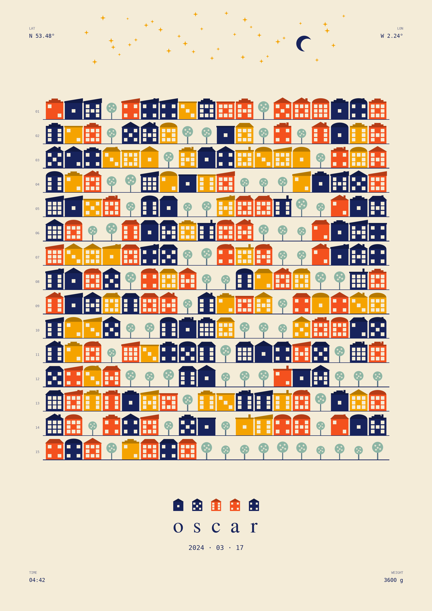

# Little town: a birth print a child can read

One script, `townprint.py`. You give it a name, a date, a time, a weight, a place and a message. It writes the print, a preview and the sealed card that explains how to read the message.

The message is built into a town. Every letter is a house and every gap between words is a tree. The cipher is made for a child of about eight: count the windows, look at the colour, find the letter in a chart. The town holds up to 300 characters, which is about 50 words.



## 1. Set up (once)

1. Install Python 3.9 or newer from python.org if you don't have it. To check, open a terminal and type `python3 --version` (on Windows: `py --version`).
2. Install the three libraries it needs:

   ```
   python3 -m pip install matplotlib numpy pillow
   ```

   On Windows use `py -m pip install matplotlib numpy pillow`.

## 2. Run it

Open a terminal in this folder (`styles/little-town`) and run this as one line with your own details in the quotes:

```
python3 townprint.py --name "oscar" --date 20240317 --time 04:42 --weight "3600 g" --coords "N 53.48, W 2.24" --message "the quick brown fox" --size "A3 portrait"
```

On Windows, start the line with `py` instead of `python3`.

If you'd rather not type the options, run `python3 townprint.py` on its own and it asks for each detail in turn.

## 3. What you get

Everything lands in a folder called `out`, named after the name you gave. The repo's `.gitignore` excludes `out`, so a real print is never committed by accident.

| File | What it is |
|---|---|
| `oscar_print.pdf` | The artwork, vector, at the exact print size. This is the one to print. |
| `oscar_preview.png` | A picture of it to look at on screen. |
| `oscar_card.pdf` | The sealed card: how to read the houses, an empty chart to fill in with a pencil, and a worked example. A5, two sides. |
| `oscar_card_with_table.pdf` | The same card plus a third page with the finished chart. Keep this one somewhere else. |

Neither card contains the message.

## 4. What you can type

The script tidies each detail before using it, so these all mean the same thing:

| Detail | Accepted, for example |
|---|---|
| Name | `oscar`, `Oscar`, `OSCAR`. Up to 24 letters. Accents, spaces and hyphens are shown on the print but ignored by the cipher. |
| Date | `20240317`, `2024-03-17`, `17 March 2024`. `17/03/2024` is accepted; `03/04/2024` is refused because it could be read two ways. |
| Time | `04:42`, `4:42`, `0442`, `4:42 am`. |
| Weight | `3600 g`, `3600`, `3.6 kg`, `7 lb 15 oz`. It is always printed in grams. |
| Coordinates | `N 53.48, W 2.24`, `53.48 N 2.24 W`, `53.48, -2.24`. |
| Print size | `A3 portrait`, `A2`, `A3 landscape`, `300x400 mm`, `12x16 in`. |

The message:

- Letters and spaces only. Punctuation is dropped; numbers must be spelled out.
- Up to 300 characters including spaces. That is about 50 words.
- No word longer than 20 letters. A word is never split over two streets.
- The script picks the number of streets from the message, so the houses are as big as the sheet allows. A shorter message gives bigger houses and bigger windows, which are easier for a child to count:

  | Message | Town on A3 portrait | House width | Window width |
  |---|---|---|---|
  | 19 characters, 4 words | 4 streets | 34 mm | 6.5 mm |
  | 99 characters, 20 words | 9 streets | 21 mm | 4.1 mm |
  | 146 characters, 29 words | 13 streets | 17 mm | 3.2 mm |
  | 251 characters, 51 words | 15 streets | 13 mm | 2.5 mm |
  | 300 characters, 62 words | 17 streets | 12 mm | 2.4 mm |

  The sizes depend on the words as well as the count, because the streets break between words. For a young reader, 20 to 30 words on A3 keeps the windows above 3 mm; for a longer message, a bigger sheet does the same.

If something can't be understood, the script stops and says which detail to fix. It never guesses.

## 5. Check it before you print

Add `--verify` to the same command. The script then draws the sheet again, reads every house and tree back out of the picture, and turns the houses into text with the chart:

```
python3 townprint.py --name "oscar" ... --verify
```

The last line should read `error rate: 0 / ... houses and trees = 0.00%`. It takes a few seconds.

This checks the drawing, not a photo of it. Unlike growth-rings, this style has no `--decode` to read a photo of the print.

## 6. Printing

- Print the PDF at 100% ("actual size"), not "fit to page".
- The cream background is part of the PDF. If you are printing on cream paper instead, add `--no-background`. The windows are cut out of the houses, so the paper shows through them.
- If a print shop asks for bleed, add `--bleed 3` (3 mm extra on every side for them to trim).
- Print the card in colour. The chart on it is filled in by hand, so plain paper that takes a pencil is best.

## 7. Other options

| Option | What it does |
|---|---|
| `--palette 2` | The three house colours: 1 harbour (the default: navy, orange-red, marigold), 2 meadow (forest, teal, straw), 3 dusk (aubergine, cobalt, amber). |
| `--samples` | Also writes a small picture in each palette. |
| `--chart-sheet` | Also writes a picture of the finished chart, all 26 houses, with a test sentence. |
| `--no-sky` | Leaves out the sun or moon and the birds or stars. |
| `--out folder` | Writes somewhere other than `out`. |
| `--dpi 300` | Sharper preview picture. Does not affect the PDF. |
| `--serif-font file.ttf`, `--mono-font file.ttf` | Use your own typefaces for the name and the read-outs. |

## 8. Same inputs, same art

There is no clock and no random seed in the script: everything is worked out from what you type. Run it twice with the same details and you get identical files. On a different computer or a different version of the libraries the artwork is the same, though the files may not match byte for byte.

Tested on macOS with Python 3.13.7, matplotlib 3.11.2, numpy 2.5.5 and Pillow 13.0.0. It has not been run on Windows or Linux, though it uses nothing specific to macOS.

## 9. What the print shows

- One house for each letter of the message, read like a page: the top street first, left to right. The small numbers down the side count the streets.
- Each house has 1 to 9 windows and one of three colours. Those two things say which letter it is. Section 10 explains how.
- A tree is a gap between words. A street always ends at the end of a word, so the end of a street is a gap too. Where a street has room to spare, some gaps get a second or third tree.
- The trees are drawn for the season of the birthday: blossom in spring, full in summer, dropping leaves in autumn, bare in winter. North of the equator the script counts March to May as spring, June to August as summer, and so on. South of the equator it turns the seasons round. The latitude decides which.
- The sky shows the time of birth. From 06:00 to 18:00 there is a sun, which crosses from left to right over those twelve hours. From 18:00 to 06:00 there is a moon, which does the same through the night.
- With a sun come birds; with a moon come stars. There is one for every hundred grams of the weight.
- The small houses above the name spell the name, as a clue.
- The roofs and chimneys vary from house to house so the town looks hand-built. They are picked from the name and the date and mean nothing.
- Only the name is the key. The date, time, weight, latitude and longitude shape the picture but not the cipher.

## 10. How the cipher works

The sealed card walks a child through this with pictures and an empty chart to fill in. In short:

1. **Count the windows.** A house has 1 to 9 windows, laid out like the spots on a dice.
2. **Look at the colour.** There are three, called colour 1, 2 and 3 from darkest to lightest.
3. **Fill in the chart.** The chart has three rows, one for each colour, and nine columns, one for each number of windows. Write the first letter of the name in the first box, then carry on with the alphabet, one letter to a box, along the top row, then the middle, then the bottom. After z comes a. The 26 letters leave the last box empty.
4. **Read.** Each house's colour picks the row and its windows pick the column.

For the placeholder name, oscar, the chart starts with o:

| | 1 | 2 | 3 | 4 | 5 | 6 | 7 | 8 | 9 |
|---|---|---|---|---|---|---|---|---|---|
| colour 1 | o | p | q | r | s | t | u | v | w |
| colour 2 | x | y | z | a | b | c | d | e | f |
| colour 3 | g | h | i | j | k | l | m | n | |

So a navy house with five windows is `s`, and an orange-red house with four windows is `a`.

### How it compares with patchwork

| | patchwork | little town |
|---|---|---|
| Key | name, date, time and weight | first letter of the name |
| Steps to build the table | mix the alphabet, deal it into three piles, add up digits three times | write the alphabet out once |
| Reading a sign | find which of nine points a shape sits on | count windows |
| Spaces | a sign like any other | a tree, so the words can be seen at a glance |

## 11. How secret is the message

Not at all, and it is not meant to be. The key is the first letter of the name, which is printed on the sheet, so there are only 26 possible charts. Anyone who knows the method can read it, and the words show their lengths. Treat it as a first cipher for a child, not as a way to keep something private.

## 12. What has and has not been tested

- `--verify` reads every house back with no errors on the examples in section 13 and on a set of edge cases: a one-letter name and message, a 24-letter name, A3 landscape, a 100 x 150 mm sheet with bleed, each palette, each season, sun and moon. Two runs with the same details gave identical files.
- An AI reader was given only the card and close-up pictures of the placeholder print. It built the chart, passed the name check and read the first eight streets correctly. It found houses with seven, eight or nine windows the hardest to count, and settled some of them by checking that the word made sense.
- After that test the windows were made bigger and the card was reworded. That later version has passed `--verify` but has not had a second cold read.
- It has not been tried with a real child, and it has not been printed on paper.

## 13. Examples

Everything in `examples/` was made from placeholder details. The main set uses the details in section 2 with a longer message of 51 words (251 characters), plus `--out examples --chart-sheet --samples`:

> you arrived before the sun on a cold spring morning and the whole house woke to meet you we counted your fingers and your toes and then we counted them again this town keeps the first words we said to you welcome little one we are so glad you are here

| File | What it is |
|---|---|
| `oscar_print.pdf`, `oscar_preview.png` | The print in palette 1, A3 portrait. |
| `oscar_card.pdf` | The sealed card for that print. |
| `oscar_card_with_table.pdf` | The same card with the finished chart. |
| `oscar_chart.png` | The 26 houses, the letters they stand for under the placeholder name, and a test sentence. |
| `oscar_palette1_harbour.png`, `oscar_palette2_meadow.png`, `oscar_palette3_dusk.png` | The three palettes from the same details. |
| `short_message_19_characters.png`, `full_message_300_characters.png` | What a short message and a full-length one look like. |
| `by_day_in_autumn.png` | The same name with an afternoon in October: a sun, birds and autumn trees. |
