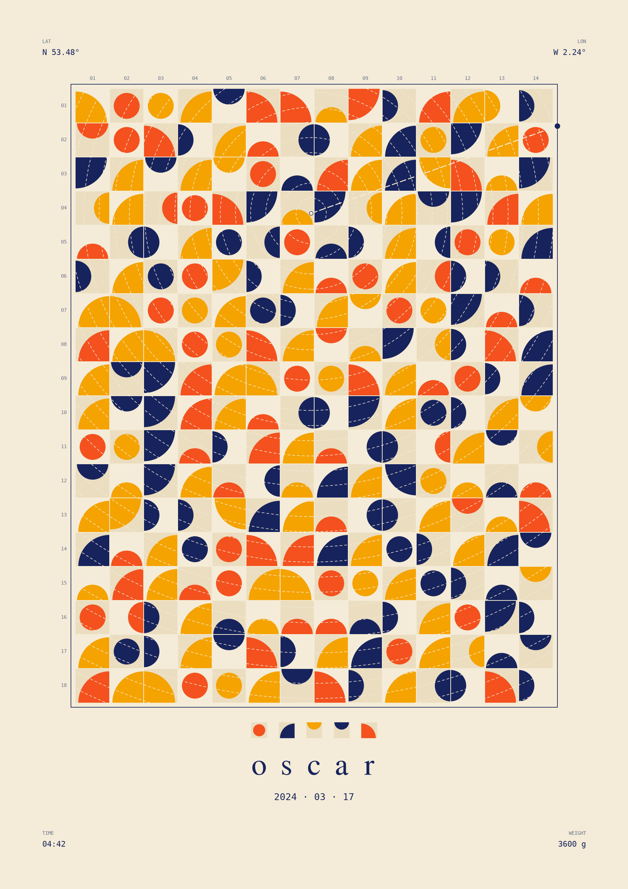

# Patchwork: a birth quilt

One script, `quiltprint.py`. You give it a name, a date, a time, a weight, a place and a message. It writes the print, a preview and the sealed card that explains how to read the message.

The message is sewn into the quilt, one patch for each letter and space. It holds up to 300 characters, which is about 50 words.



## 1. Set up (once)

1. Install Python 3.9 or newer from python.org if you don't have it. To check, open a terminal and type `python3 --version` (on Windows: `py --version`).
2. Install the three libraries it needs:

   ```
   python3 -m pip install matplotlib numpy pillow
   ```

   On Windows use `py -m pip install matplotlib numpy pillow`.

## 2. Run it

Open a terminal in this folder (`styles/patchwork`) and run this as one line with your own details in the quotes:

```
python3 quiltprint.py --name "oscar" --date 20240317 --time 04:42 --weight "3600 g" --coords "N 53.48, W 2.24" --message "the quick brown fox" --size "A3 portrait"
```

On Windows, start the line with `py` instead of `python3`.

If you'd rather not type the options, run `python3 quiltprint.py` on its own and it asks for each detail in turn.

## 3. What you get

Everything lands in a folder called `out`, named after the name you gave. The repo's `.gitignore` excludes `out`, so a real print is never committed by accident.

| File | What it is |
|---|---|
| `oscar_print.pdf` | The artwork, vector, at the exact print size. This is the one to print. |
| `oscar_preview.png` | A picture of it to look at on screen. |
| `oscar_card.pdf` | The sealed card: the decoding method and a worked example. A5, two sides. |
| `oscar_card_with_table.pdf` | The same card plus a third page with the three finished grids. Keep this one somewhere else. |

Neither card contains the message.

## 4. What you can type

The script tidies each detail before using it, so these all mean the same thing:

| Detail | Accepted, for example |
|---|---|
| Name | `oscar`, `Oscar`, `OSCAR`. Up to 24 letters. Accents, spaces and hyphens are shown on the print but ignored by the cipher. |
| Date | `20240317`, `2024-03-17`, `17 March 2024`. `17/03/2024` is accepted; `03/04/2024` is refused because it could be read two ways. |
| Time | `04:42`, `4:42`, `0442`, `4:42 am`. |
| Weight | `3600 g`, `3600`, `3.6 kg`, `7 lb 15 oz`. It is always printed in grams. |
| Coordinates | `N 53.48, W 2.24`, `53.48 N 2.24 W`, `53.48, -2.24`. |
| Print size | `A3 portrait`, `A2`, `A3 landscape`, `300x400 mm`, `12x16 in`. |

The message:

- Letters and spaces only. Punctuation is dropped; numbers must be spelled out.
- Up to 300 characters including spaces. That is about 50 words.
- The script picks the shape of the quilt from the length, so the patches are as big as the sheet allows:

  | Message length | Quilt on A3 portrait | Patch width |
  |---|---|---|
  | 20 characters | 5 rows of 4 | 34 mm |
  | 100 | 12 rows of 9 | 24 mm |
  | 150 | 14 rows of 11 | 21 mm |
  | 252 | 18 rows of 14 | 16 mm |
  | 300 | 19 rows of 16 | 15 mm |

- If the message does not fill the last row, the spare patches are left empty and marked with a small cross.

If something can't be understood, the script stops and says which detail to fix. It never guesses.

## 5. Check it before you print

Add `--verify` to the same command. The script then draws the sheet again, reads every patch back out of the picture, and turns the patches into text with the grids:

```
python3 quiltprint.py --name "oscar" ... --verify
```

The last line should read `error rate: 0 / ... patches = 0.00%`. It takes a few seconds.

This checks the drawing, not a photo of it. Unlike growth-rings, this style has no `--decode` to read a photo of the print.

## 6. Printing

- Print the PDF at 100% ("actual size"), not "fit to page".
- The cream background is part of the PDF. If you are printing on cream paper instead, add `--no-background`.
- If a print shop asks for bleed, add `--bleed 3` (3 mm extra on every side for them to trim).

## 7. Other options

| Option | What it does |
|---|---|
| `--palette 2` | The three inks: 1 harbour (the default: navy, orange-red, marigold), 2 meadow (forest, teal, straw), 3 dusk (aubergine, cobalt, amber). |
| `--samples` | Also writes a small picture in each palette. |
| `--patch-sheet` | Also writes the chart of all 27 patches. |
| `--no-stitches` | Leaves out the quilting lines. |
| `--out folder` | Writes somewhere other than `out`. |
| `--dpi 300` | Sharper preview picture. Does not affect the PDF. |
| `--serif-font file.ttf`, `--mono-font file.ttf` | Use your own typefaces for the name and the read-outs. |

## 8. Same inputs, same art

There is no clock and no random seed in the script: everything is worked out from what you type. Run it twice with the same details and you get identical files. On a different computer or a different version of the libraries the artwork is the same, though the files may not match byte for byte.

Tested on macOS with Python 3.13.7, matplotlib 3.11.2, numpy 2.5.5 and Pillow 13.0.0. It has not been run on Windows or Linux, though it uses nothing specific to macOS.

## 9. What the print shows

- One patch for each letter and space of the message, read like a page: top row first, left to right. The small numbers along the top and down the side count the columns and rows.
- Every patch holds one round shape in one of three inks. Where the shape sits and which ink it is in say which letter it is. Section 10 explains how.
- The pale chequered cloth behind the shapes only marks where one patch ends and the next begins.
- The dashed lines are quilting stitches. They are sewn in the colour of the paper, so they show only where they cross an ink.
- The stitched ripples spread from a small knot. Read the quilt as a map of the world, with longitude running across and latitude running down: the knot sits at the place of birth.
- There is one ripple for every hundred grams of the weight.
- One straight line of longer stitches runs from the knot to a dot on the frame. It points to the time of birth on a 24-hour dial with midnight at the top.
- The small patches above the name spell the name, as a clue.
- The latitude, longitude and stitching are decoration. The name, date, time and weight are the key.

## 10. How the cipher works

The sealed card walks through this with pictures. In short:

1. **Nine points.** A patch is a square. Number nine points on it the way you read a page: the corners are 1, 3, 7 and 9, the middles of the sides are 2, 4, 6 and 8, and the centre is 5. The round shape in a patch is centred on one of them: a quarter circle on a corner, a half circle on a side, a whole circle on the centre.
2. **Three inks.** Nine points in three inks make 27 patches: 26 letters and the space. The inks are ranked from darkest to lightest, so the print can still be read from a grey photocopy.
3. **The name mixes the alphabet.** Write the name across a line, skipping repeated letters. Write the rest of the alphabet under it in rows of the same width, then a dash for the space. Copy the columns out in the alphabetical order of their top letters.
4. **Deal into three piles.** Deal that row of 27 like a pack of cards: first sign to ink 1, second to ink 2, third to ink 3, and round again. Each ink gets nine signs.
5. **Three numbers turn the grids.** Each ink's nine signs go round its nine points in order, but the starting point moves. The date sets it for ink 1, the time for ink 2 and the weight for ink 3. Add up the digits of the number until one digit is left, count a 9 as 0, and skip that many points.

For the placeholder details the date 20240317 gives 2+0+2+4+0+3+1+7 = 19, then 1+9 = 10, then 1+0 = 1. So ink 1 skips one point and its first sign, `a`, sits on point 2: a navy half circle hanging from the top edge.

## 11. How secret is the message

Not very, and it is not meant to be. The name and the three numbers that make the key are printed on the sheet, and this script is public. Anyone who has both can read the message. Each letter is always the same patch, so a patient reader could also work a long message out by counting which patches come up most. Treat it as a keepsake puzzle, not as a way to keep something private.

## 12. Examples

Everything in `examples/` was made from placeholder details. The main set uses the details in section 2 with a longer message of 51 words (252 characters), plus `--out examples --patch-sheet --samples`:

> you arrived before the sun on a cold spring morning and the whole house woke to meet you we counted your fingers and your toes and then we counted them again this quilt keeps the first words we said to you welcome little one we are so glad you are here

| File | What it is |
|---|---|
| `oscar_print.pdf`, `oscar_preview.png` | The print in palette 1, A3 portrait. |
| `oscar_card.pdf` | The sealed card for that print. |
| `oscar_card_with_table.pdf` | The same card with the three finished grids. |
| `oscar_patches.png` | The 27 patches, the signs they stand for under the placeholder key, and a test sentence. |
| `oscar_palette1_harbour.png`, `oscar_palette2_meadow.png`, `oscar_palette3_dusk.png` | The three palettes from the same details. |
| `short_message_19_characters.png`, `full_message_300_characters.png` | What a short message and a full-length one look like. |
